# 🔥 Streakly

> **OPSC6312 — Portfolio of Evidence Part 3 (Final Submission)**
> **Authors:** Tumisho Kokhutja (ST10446195), Mzamo Richmond Ndlovu (ST10455453), Lesego Ayanda Mathe (ST10440650)


**Small habits. Big changes.** Streakly is an offline-first Android habit tracker written in Kotlin. Build daily habits, protect your streaks, earn XP and badges, and redeem rewards you create yourself. It works without a connection, syncs automatically when you are back online, and nudges you with push notifications before a streak breaks. The whole app is available in **English, isiZulu and Setswana**.

| | Link |
|---|---|
| ▶️ **PoE demonstration video** | _Add the unlisted YouTube link before submission_ |
| Prototype history | Part 2 features are retained and extended in this final Part 3 release |
| Release notes | [RELEASE_NOTES.md](RELEASE_NOTES.md) |
| AI-use statement | [docs/AI_USE.md](docs/AI_USE.md) |
| Privacy policy | [docs/privacy-policy.html](docs/privacy-policy.html) |
| Play Store material | [docs/PLAY_STORE.md](docs/PLAY_STORE.md) |

## Screens

The physical-phone screenshots are stored in the repository's `assets/` folder.
GitHub renders them automatically in this gallery. Where an exact capture was not
available, the closest matching app screenshot is reused as a visual preview.

| Screen | Screenshot |
|---|---|
| Play Store |  |
| Splash | 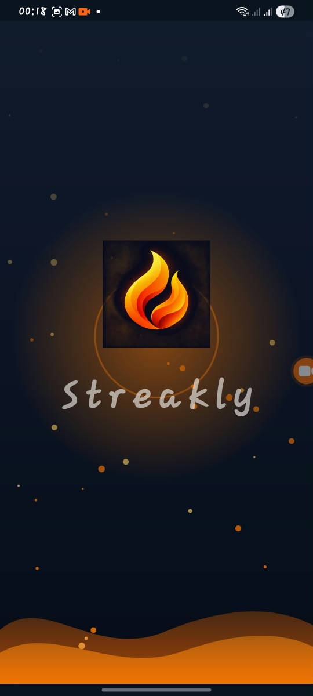 |
| Onboarding | 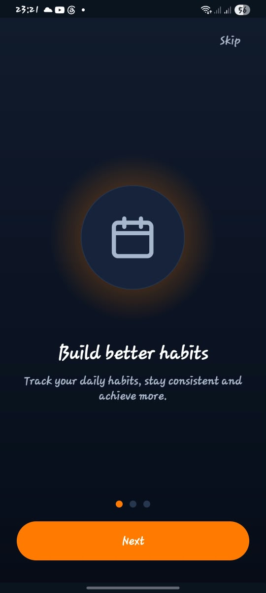 |
| Welcome |  |
| Login | (assets/register.jpeg) |
| Register | 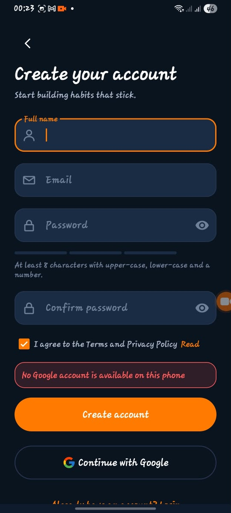 |
| Forgot password | 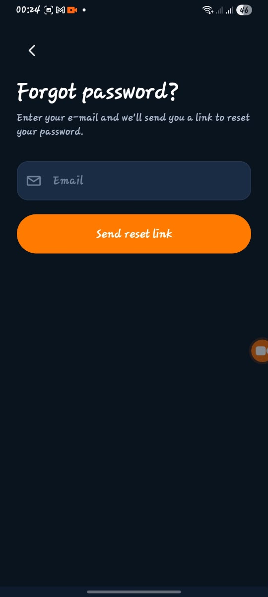 |
| Email verification |  |
| Main dashboard / home | 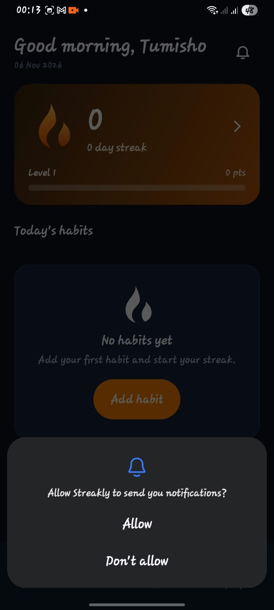 |
| Calendar | 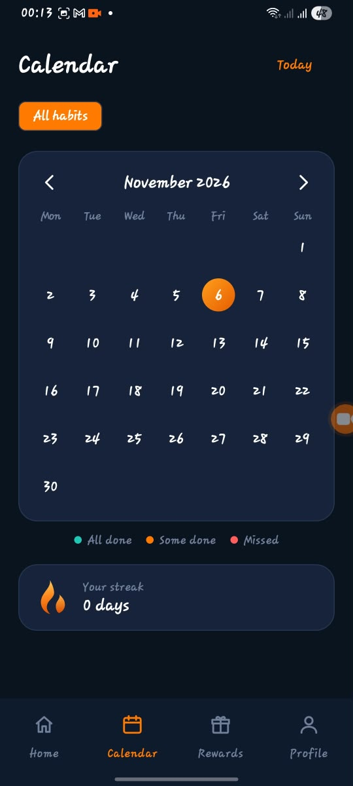 |
| Rewards | 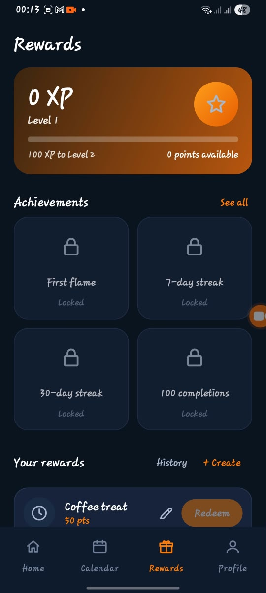 |
| Profile | 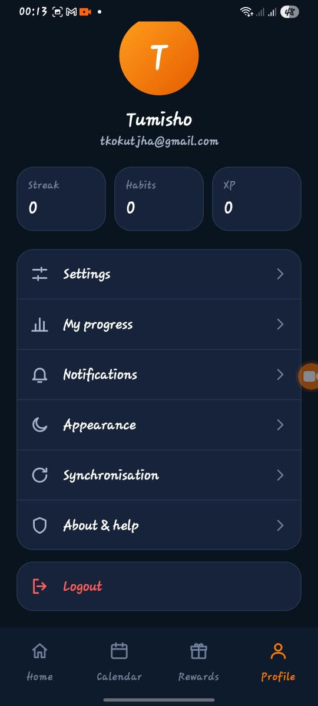 |
| Add/edit habit | 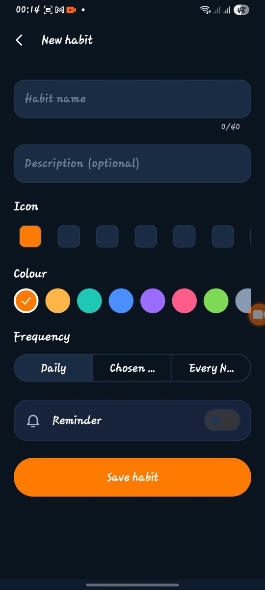 |
| Habit details |  |
| Create/edit reward |  |
| Badges | 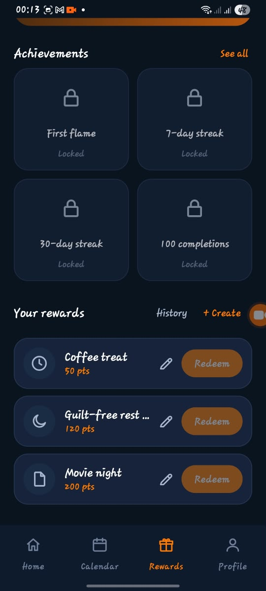 |
| Reward history | 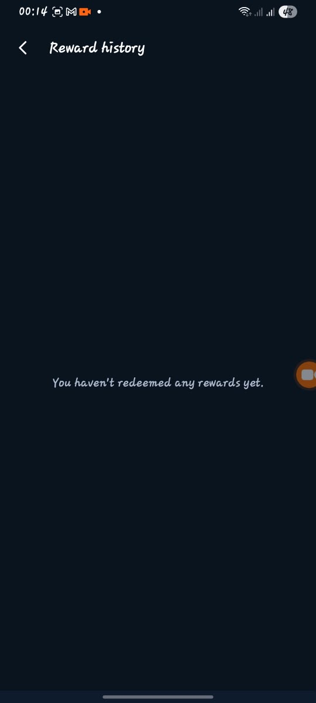 |
| Statistics | 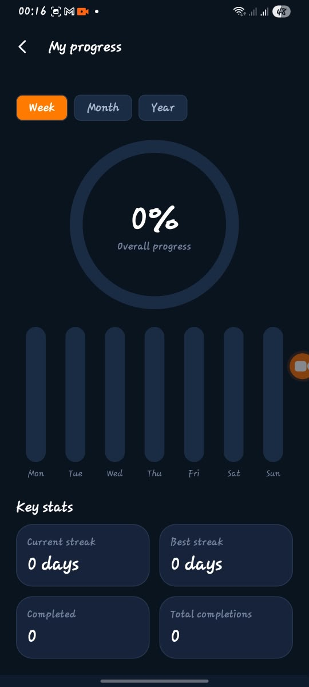 |
| Sync status | 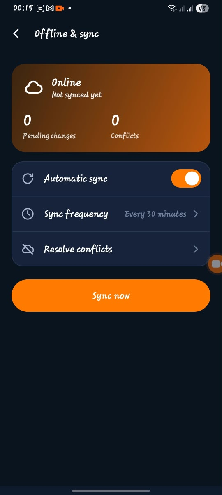 |
| Settings | 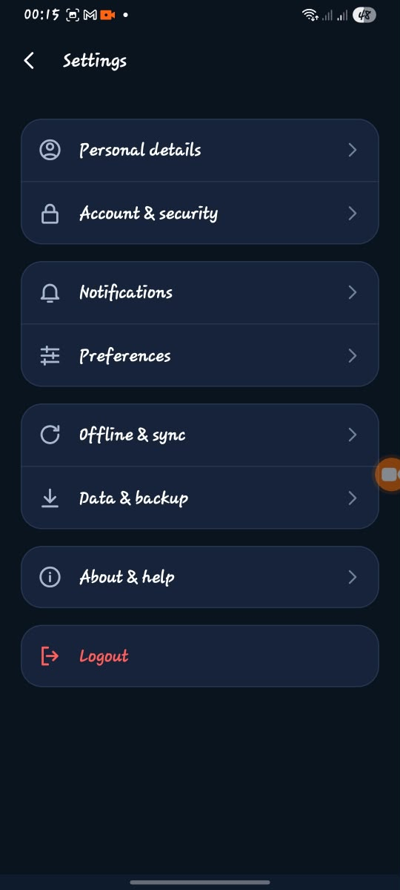 |
| Personal details | 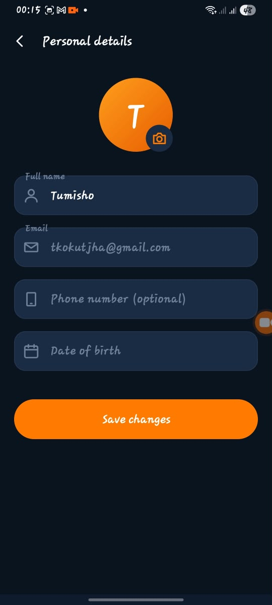 |
| Account security | 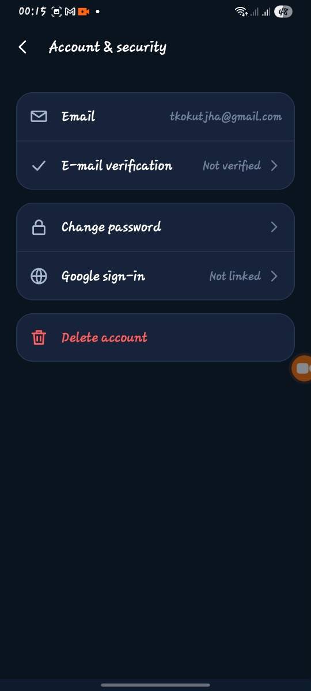 |
| Notifications |  |
| Preferences | 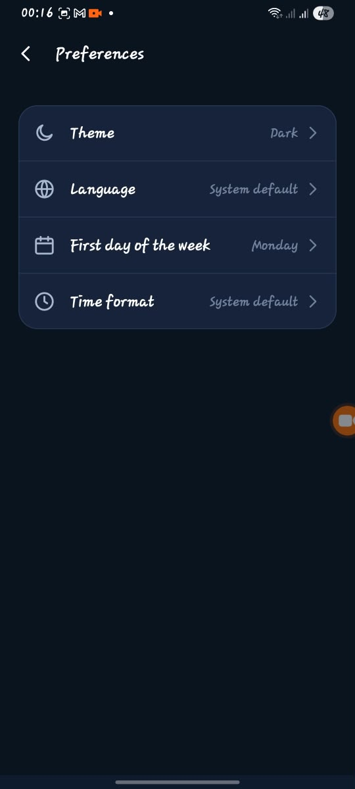 |
| Offline sync |  |
| Data backup / export | 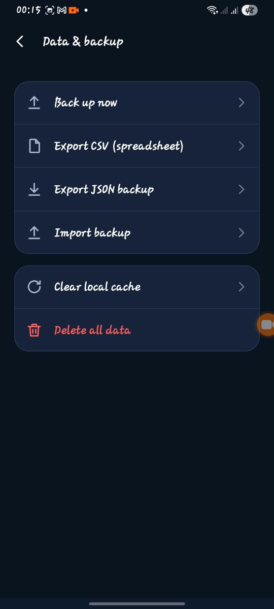 |
| About | 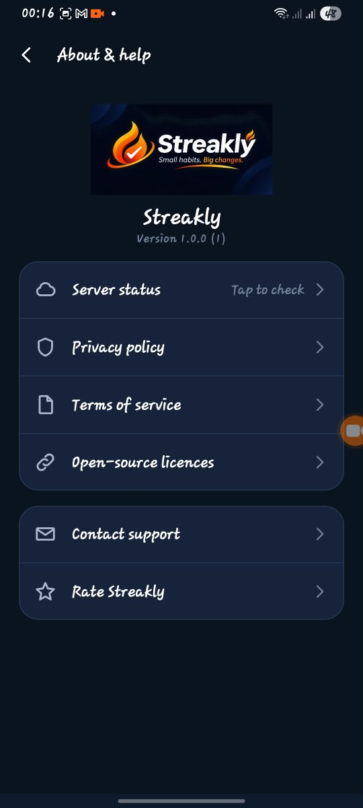 |
| Theme selection | 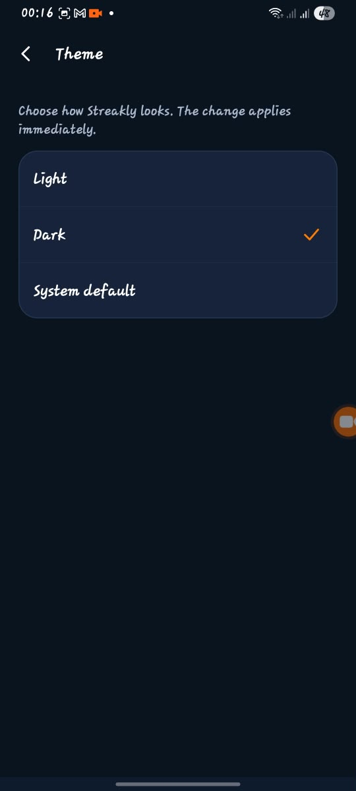 |
| Language selection | 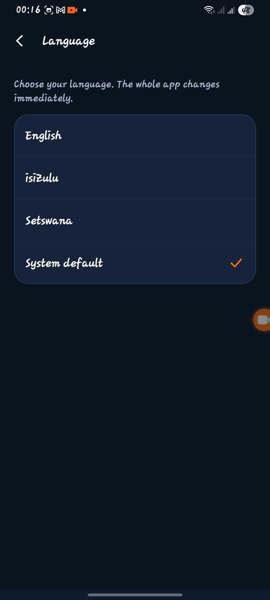 |

Additional onboarding captures are available as
`assets/onboarding_habits.jpeg`, `assets/onboarding_offline.jpeg`, and
`assets/onboarding_rewards.jpeg`. An alternate offline-sync capture is available
as `assets/offline_sync_alternate.jpeg`.

## PoE rubric coverage

| PoE criterion | Where it lives | How to see it |
|---|---|---|
| App runs on a mobile device | Signed release build, animated splash, bottom navigation | Install the signed APK on a physical phone and run the whole demo |
| **SSO login** | `AuthRepository` (Credential Manager + Firebase), Welcome / Login / Register screens, Settings ▸ Account & security (link / unlink Google) | Requires a Firebase Web OAuth client in the local/CI `google-services.json`; then tap **Continue with Google** and verify provider `google.com` in Firebase Authentication |
| **Offline mode with sync** | Room (single source of truth), `SyncRepository`, `SyncWorker` (WorkManager), `/api/sync`, conflict screen | Airplane mode ▸ complete habits ▸ reconnect ▸ pending count drops to 0 and rows appear in Firestore |
| **Real-time notifications** | `StreaklyMessagingService` (FCM data messages), `/api/jobs/streak-risk`, `/api/push/test`, deep links | Settings ▸ Notifications ▸ **Send a test notification**; works foreground, background and killed |
| **Multi-language** | `values/`, `values-zu/`, `values-tn/` (≈ 360 strings + plurals), per-app locale API | Settings ▸ Preferences ▸ Language: the entire UI changes instantly and persists |
| User-defined 4 | **My Progress** analytics: week / month / year completion ring, bar chart, key stats, per-habit breakdown | Profile ▸ My progress |
| User-defined 5 | **Cloud profile & data portability**: profile photo in Firebase Storage, JSON / CSV export, backup import, clear cache, delete-all | Settings ▸ Personal details and Settings ▸ Data & backup |
| Play Store preparation | Signed AAB/APK workflow, adaptive icon, store text, privacy policy, Data-safety answers | [docs/PLAY_STORE.md](docs/PLAY_STORE.md) |
| User interface | One design system for all 30+ screens (navy + flame orange), dark / light theme, empty / loading / error states, inline validation | Screenshots above |
| GitHub, README, automated testing | 43 Kotlin unit tests + 33 API tests, GitHub Actions on every push, final tag pending | [Actions tab](../../actions) |
| Demonstration video | Script in [docs/DEMO_SCRIPT.md](docs/DEMO_SCRIPT.md) | — |

**Final Part 3 scope:** The prototype features (habit scheduling and logging, streak analytics, points, levels, badges and rewards) are retained as the foundation. This final submission adds SSO, offline sync, push notifications, South African language support, progress analytics, cloud profile/data portability, and Play Store preparation.

## Architecture

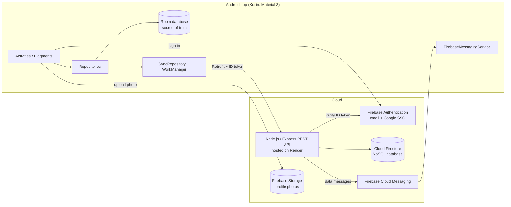

* **Room is the source of truth.** Every screen observes Room, so the app is fully usable offline. All writes are flagged `PENDING` and a WorkManager job (network-constrained, exponential back-off) uploads them as soon as a connection exists.
* **Conflict handling.** Each row remembers the server version it was based on. If the cloud copy changed on another device, the API refuses to overwrite and returns it; the *Sync status* screen shows both versions and lets the user keep either one.
* **Security.** Passwords are hashed and stored by Firebase Authentication (we never see them). The API verifies the Firebase ID token on every request; Firestore rules deny direct client access; Storage rules limit each user to their own photo.
* **Why these stores?** Relational-style habit data and sync metadata live in Firestore through our API (NoSQL, per-user documents). Media is blob data, so it goes to Firebase Storage. The phone keeps a Room copy for offline use.

## REST API

Base URL = `API_BASE_URL`. All `/api/*` routes except the job need `Authorization: Bearer <Firebase ID token>`.

| Method | Path | Purpose |
|---|---|---|
| GET | `/health` | Liveness + which store is active |
| POST | `/api/sync` | Upload pending rows (`since`, `changes`) and receive changes + conflicts |
| POST / DELETE | `/api/devices` | Register / remove an FCM token (with language and time zone) |
| POST | `/api/push/test` | Send a real push to the caller's devices |
| DELETE | `/api/account` | Delete all of the caller's cloud data |
| POST | `/api/jobs/streak-risk` | Nightly job (header `x-job-secret`): push "streak at risk" alerts |

## Setup

### 1. Firebase (once)
1. Create a Firebase project. Add an **Android app** with package `com.streakly.app`.
2. **Authentication ▸ Sign-in method:** enable *Email/Password* and *Google*.
3. Add your **SHA-1 and SHA-256** fingerprints (debug: `./gradlew signingReport`; also your release/upload key and, later, the Play App Signing key) to the Android app, then download **`google-services.json`** into `app/` (it is git-ignored).
4. Enable **Cloud Firestore** (production mode) and **Storage**. Publish `firebase/firestore.rules` and `firebase/storage.rules`.
5. **Project settings ▸ Service accounts ▸ Generate new private key** for the API (never commit it).

### 2. Host the API (Render, free)
1. Push the repo to GitHub, then on Render choose **New ▸ Blueprint** and pick the repo (`render.yaml`).
2. Set `FIREBASE_SERVICE_ACCOUNT` to the service-account JSON on **one line**. Note the generated `JOB_SECRET`.
3. Open `https://YOUR-SERVICE.onrender.com/health`. It should return `"store":"firestore"`.
4. Nightly alerts: create a Render *Cron Job* (or a scheduled GitHub Action) that runs  
   `curl -X POST -H "x-job-secret: $JOB_SECRET" "https://YOUR-SERVICE.onrender.com/api/jobs/streak-risk"`

Local API for development: `cd server && npm ci && ALLOW_INSECURE_DEV_AUTH=1 npm start` (file store, header auth, emulator URL `http://10.0.2.2:3000/`).

### 3. Build the app
```bash
cp local.properties.example local.properties   # set sdk.dir and API_BASE_URL
./gradlew testDebugUnitTest assembleDebug
```
Install `app/build/outputs/apk/debug/app-debug.apk` on a phone (USB debugging). **Free Render instances sleep:** open `/health` a minute before demonstrating.

### 4. Signed release (Play Store)
```bash
keytool -genkey -v -keystore upload.jks -keyalg RSA -keysize 2048 -validity 10000 -alias upload
KEYSTORE_PATH=upload.jks KEYSTORE_PASSWORD=… KEY_ALIAS=upload KEY_PASSWORD=… ./gradlew assembleRelease bundleRelease
```
Or push a tag (`git tag -a v1.0.0-final-poe -m "Final PoE" && git push origin v1.0.0-final-poe`) and the **Release** workflow builds, signs and publishes both files from repository secrets (`GOOGLE_SERVICES_JSON` as base64, `KEYSTORE_B64`, `KEYSTORE_PASSWORD`, `KEY_ALIAS`, `KEY_PASSWORD`; optional variable `API_BASE_URL`).

## Testing & GitHub Actions

| Suite | Count | Run |
|---|---|---|
| Kotlin unit tests (streaks, gamification, validation, sync merge rules, calendar/date maths, export) | 43 | `./gradlew testDebugUnitTest` |
| API tests (auth, models, sync, conflicts, devices, push, account deletion, streak job, file store) | 33 | `cd server && npm test` |

`android-ci.yml` runs both suites and builds the debug APK on every push and pull request; `release.yml` builds the signed release when a version tag is pushed. When the `GOOGLE_SERVICES_JSON` secret is absent the workflow creates a placeholder file so the build still succeeds.

## Design considerations

* Dark navy surfaces with a single flame-orange accent, matching the Streakly logo; light and system themes are supported.
* Teal means "done", orange means "act", red means "at risk": colour is never the only signal (icons and text accompany it).
* One shared set of components (settings rows, stat cards, rings, bar charts) keeps spacing, type and shape identical across screens.
* Forms validate inline in plain language; destructive actions always ask first; every list has an empty state.
* Animated launch: the flame ignites, a glow breathes, ripples radiate and embers rise while the wordmark tracks in.

## Project structure

```
app/src/main/java/com/streakly/app/
  data/        Room entities + DAOs, Retrofit API, repositories (auth, habits, rewards, sync)
  push/        FCM service, notification channels, deep-link intents
  worker/      SyncWorker, ReminderWorker (WorkManager)
  utils/       StreakCalculator, Gamification, SyncMerge, Validators, export helpers (unit tested)
  ui/          splash, onboarding, auth, main tabs, habit, rewards, stats, settings, sync
server/        Express API, Firestore + file stores, Jest tests
firebase/      Firestore + Storage security rules
docs/          privacy policy, Play Store listing, demo script, AI-use statement
```

## Referencing

Code comments name the source where an approach was adapted. Full Harvard reference list: see [docs/REFERENCES.md](docs/REFERENCES.md).
